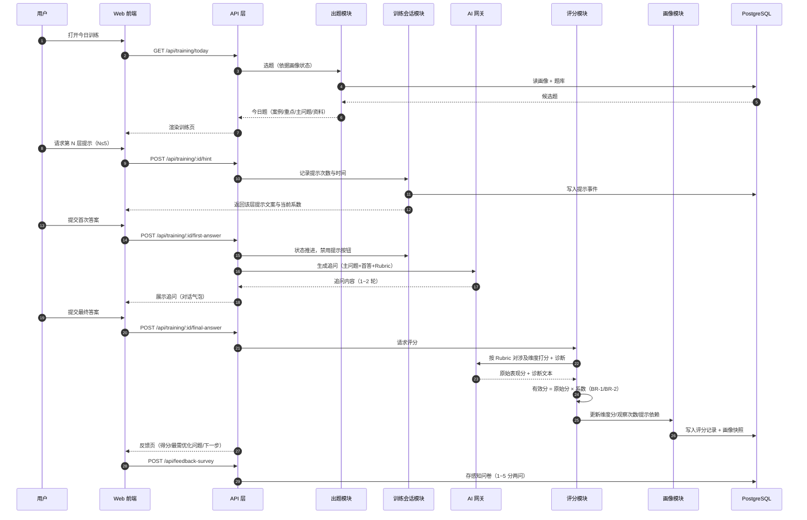
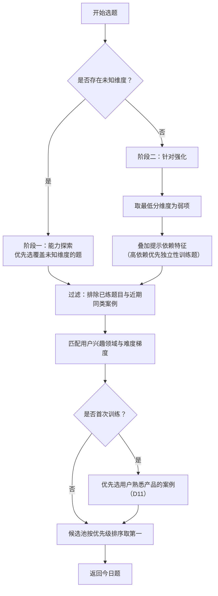
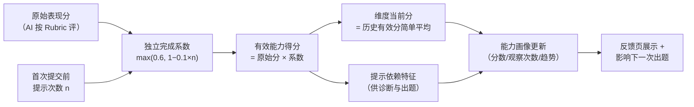

# PRD：自适应产品经理训练平台 · MVP（V1 锁定版）

| 项目 | 内容 |
|---|---|
| 版本 | v1.0（立项锁定版） |
| 日期 | 2026-10-02 |
| 状态 | 需求已锁定，等待开发启动 |
| 选定原型 | 原型 B「成长驾驶舱」（`prototypes/prototype-b-dashboard.html`） |
| 平台 | 桌面 Web 优先（单端） |

---

## 0. 已锁定决策记录

| # | 决策点 | 结论 |
|---|---|---|
| D1 | 内容生产方式 | 预置精品题库 30~50 道，人工 + AI 半自动预产；每题含案例、主问题、能力标签（2~4 个）、评分细则（Rubric）、难度、预策展资料、5 层提示树 |
| D2 | 能力测评 | 移至 V2，V1 仅通过自然训练建立画像 |
| D3 | 训练节奏 | 每日一题为主入口，完成后可加练；加练同等计入画像 |
| D4 | 平台 | 桌面 Web 优先，单端 |
| D5 | 提示层级 | 每题固定 5 层渐进提示 |
| D6 | 追问轮次 | 1~2 轮；单次训练目标时长 15~25 分钟 |
| D7 | 提示按钮生命周期 | 首次提交后本题内永久消失，杜绝"先瞎答触发追问绕过扣分"的套利空间 |
| D8 | 分数存储 | 四元组分开存储：原始表现分、提示次数、独立完成系数、有效得分 |
| D9 | 资料形态 | 站内精编摘要 + 原文链接；预先策展，不实时抓取 |
| D10 | 原型方向 | 选定原型 B；追问环节吸收原型 C 的对话气泡呈现；反馈页保留"情感峰值"设计 |
| D11 | 首日体验 | 首题案例优先选择用户在初始画像中填写的熟悉产品（首日"它懂我"时刻） |
| D12 | 提示透明化 | 请求提示时界面明示当前独立完成系数（如"当前 ×0.9"） |
| D13 | LLM 供应商 | 小米 MiMo-V2.6-Pro（2026-09-22 发布，MIT 开源，1M token 上下文）；经 MiMo 开放平台 OpenAI 兼容 API 接入，模型 ID `mimo-v2.6-pro`；月度预算不封顶，保留调用量监控与告警（对应 R5） |
| D14 | 题库生产 | 评审人：产品负责人本人；滚动排期：首日产出 12~15 题最小可用集（8 维度全覆盖、每维 ≥2 题），上线后每周滚动补充约 10 题；评分校准集（R1）从首批沉淀 |
| D15 | 部署 | 云服务器自托管（阿里云或腾讯云）；PostgreSQL 用云 RDS；静态资源用 OSS/COS；域名 ICP 备案需提前 2~4 周启动 |
| D16 | 感知问卷 | 周期性一问每 5 次训练触发一次 |
| D17 | 账号体系 | 邮箱魔法链接登录（一次性链接，15 分钟有效，token 哈希存储）；身份模型采用 users + auth_identities 可扩展结构，为 V2 增加验证码 / 微信扫码等登录方式预留底子；V1 不做账号密码登录 |
| D18 | 案例事实引用 | 案例背景五要素（产品/服务谁/场景/相关功能/当前状态）每字段必须带真实来源引用并在界面展示标记；来源优先级：官方一手 > 权威媒体 > 其他（如实标注）；无来源论断不得进入案例背景（任务 T13） |

---

## 1. 产品路线图

### 1.1 核心目标（Mission）

每天通过一个真实产品问题训练产品判断力，让 AI 随长期交互越来越了解用户，持续指出其真正需要提升的方向——不是题库，不是 AI 老师，而是一套长期、自适应的产品判断力训练系统。

### 1.2 用户画像（Persona）

**初级产品经理、转岗产品经理、承担产品职责的非正式 PM。** 已有产品概念认知，但缺乏系统实战闭环。核心痛点：

- 知识与能力断层：知道概念，遇到真实问题时思考链路断裂；
- 训练准备成本高：精力耗在找案例、找资料，而非思考本身；
- 反馈无行动价值："产品思维要加强"式反馈无法指导下一步；
- 训练彼此孤立：无积累、无针对性。

第一阶段**不服务完全零基础用户**。

### 1.3 V1：最小可行产品（MVP）

1. **初始用户画像**：2~3 分钟轻量问卷（职位、年限、行业、项目经验、熟悉产品、兴趣领域、学习目标、自评方向）；完成即进入首次训练，首题案例优先选用户熟悉的产品。
2. **今日训练（核心闭环）**：每日一题 + 可加练。链路：今日案例 → 今日训练重点 → 单一主问题 → 参考资料（核心 2 + 扩展 3）→ 自由回答（附非强制思考方向）→ 按需渐进提示（5 层，透明化系数微文案）→ 首次提交 → AI 产品总监追问（1~2 轮，提示按钮此时消失）→ 最终提交 → 针对性评分 → 反馈页（能力得分变化 + 最需要优化的一个问题 + 下一步训练方向）。
3. **能力画像**：8 个一级维度（问题定义、用户理解、根因分析、产品价值判断、方案设计、产品取舍、指标与验证、产品表达）；允许"未知"状态；展示分数 + 观察次数 + 诊断性描述（区分"深度不足"与"提示依赖"等不同病因）。
4. **训练历史**：历史案例、我的回答、提示使用、追问记录、最终反馈、能力变化。
5. **我的**：初始画像、兴趣方向、基础设置。
6. **预置精品题库**：30~50 道题（见 D1）。
7. **自适应出题 v0.1**：阶段一（能力探索，优先覆盖未知维度）+ 阶段二（针对强化，按弱项、提示依赖、兴趣、难度选题）。
8. **训练方向有效性感知问卷**：训练后轻量两问（1~5 分）+ 周期性一问。

### 1.4 V2 及以后版本

- **能力测评**：独立集中 Case Test，快速建立全维度能力基线。
- **周期复测（阶段三）**：跨产品、跨题型验证能力是否真实提升。
- 能力模型二级维度；进阶分数模型（时间衰减、难度权重、最近表现加权）。
- 特定题型结构化表单（根因假设、方案 A/B、数据指标等）。
- 移动端 / 小程序。
- 社区、排行榜、轻成就体系（待 V1 验证后再排优先级）。

### 1.5 关键业务逻辑（Business Rules）

- **BR-1 评分**：每题只测其能力标签覆盖的维度；`有效能力得分 = 原始表现分 × 独立完成系数`。
- **BR-2 独立完成系数**：`系数 = max(0.6, 1 − 0.1 × 首次提交前的提示次数)`；对照表：0 次=1.0，1 次=0.9，2 次=0.8，3 次=0.7，≥4 次=0.6。
- **BR-3 提示**：5 层渐进、逐级请求；阅读资料不扣分；请求提示时界面明示当前系数；首次提交后提示按钮消失（D7）。
- **BR-4 追问**：首答后不公布评分与参考答案；AI 以产品总监角色追问 1~2 轮（找逻辑漏洞、挑战假设、索要证据）；追问不扣分。
- **BR-5 出题**：案例可随机，训练目标不随机；探索期优先未知维度，强化期优先弱项 + 提示依赖 + 兴趣 + 难度；首题优先用户熟悉产品（D11）。
- **BR-6 画像**：初始允许未知；V1 维度分 = 该维度历史有效分的简单平均；必须基于提示依赖与答案特征输出差异化诊断（同分不同病）。
- **BR-7 反馈**：每次训练必须输出一个具体、可行动的"最需要优化的问题"，禁止泛泛结论。
- **BR-8 案例事实**：案例背景五要素每字段必须携带真实权威来源引用（结构 `{text, citations[]}` + `case_sources`），无来源论断不得进入案例背景（D18）。

### 1.6 数据契约（Data Contract）

| 对象 | 关键字段 |
|---|---|
| 用户 | 职位、年限、行业、项目经验、熟悉产品、兴趣领域、学习目标、自评方向 |
| 训练题 | 案例背景（五要素，每字段 `{text, citations[]}`）、案例来源（case_sources：标题/发布方/链接）、主问题、能力标签（2~4）、难度、评分细则、提示树（5 层）、资料（核心 2 + 扩展 3） |
| 训练会话 | 题目 ID、首次答案、首次提交前的提示次数与时间、追问对话记录、最终答案、各环节时间戳 |
| 评分记录 | 各维度四元组：原始表现分、提示次数、独立完成系数、有效得分；诊断文本；最需优化问题 |
| 能力画像 | 8 维度 ×（当前分数｜未知、观察次数、提示依赖特征、近期趋势） |
| 感知问卷 | 训练后两问（1~5 分）、周期性一问（1~5 分） |

---

## 2. 选定 MVP 原型与设计说明

### 2.1 选定：原型 B「成长驾驶舱」

**理念**：把"AI 越来越懂我"做成肉眼可见的成长面板——首页即状态：连续天数、能力总览、今日任务、最近诊断，每次打开都强化成长曲线感。"为什么练这题"的理由前置展示，让自适应价值被显性化。

**视觉基准文件**：`prototypes/prototype-b-dashboard.html`（屏 1 首页仪表盘、屏 2 能力画像页），双击可离线打开。

### 2.2 设计语言

- **布局**：左侧深色侧边栏（产品名「训练台」+ 导航：今日训练 / 能力画像 / 训练历史 / 我的）+ 主区浅灰底（#F5F6F8）白色卡片。
- **配色**：石板灰 + 主色蓝（#2563EB）；白卡微阴影；浅色主题。
- **字体**：系统黑体栈（PingFang SC / Microsoft YaHei / Noto Sans SC）；大字号数字突出分数。
- **组件语言**：卡片、横向能力条形图、SVG 趋势火花线、状态标签（稳定 / 样本较少 / ↑ 上升中）、分段进度条、空态虚线卡。
- **吸收自原型 C**：追问环节在训练页内以对话气泡呈现（AI"总监"头像 + 用户头像），保留"总监陪练"的温度。

### 2.3 页面清单与要点

| 页面 | 要点 |
|---|---|
| P1 首页仪表盘 | 问候行 + 统计条（连续 12 天、本周 5/7）；「今日任务」主卡（案例、训练重点、"为什么是它"、开始按钮）；「能力总览」卡（5/8 已解锁 + 待解锁虚态）；「最近一条诊断」引用卡 |
| P2 能力画像页 | 顶部洞察条（已了解 5/8 维度 · 下一题优先探索根因分析）；已观测维度行（分数、观察次数、火花线、状态标签）；弱项行展开特征与诊断；未观测空态卡；提示依赖度仪表条 |
| P3 今日训练流程页 | 沿用 B 设计语言：今日案例卡（五要素字段末尾内联「原文」引用链接，BR-8）、训练重点小卡、主问题、参考资料列表（★核心/○扩展）、自由回答区、提示按钮（含系数微文案、首次提交后消失）、追问对话气泡区 |
| P4 训练反馈页 | 情感峰值页：三条有效得分行（含"原始分 × 系数"小字与"查看计算过程"）；"最需要优化的一个问题"强调卡；"下一步"卡；两行 1~5 星问卷；双按钮（查看能力画像 / 再练一题） |
| P5 训练历史 | 按日期的会话列表；详情含案例、我的两版答案、提示使用、追问记录、最终反馈、能力变化 |
| P6 我的 | 初始画像查看/编辑、兴趣方向、基础设置 |

---

## 3. 架构设计蓝图

### 3.1 技术选型（AI 供应商与部署已确认：D13 / D15）

| 层 | 选型 | 理由 |
|---|---|---|
| 应用框架 | Next.js（App Router）+ TypeScript | 前后端同仓，页面 + API Route Handlers 一体，MVP 单仓交付最快 |
| UI | Tailwind CSS | 与原型卡片式设计语言匹配，迭代快 |
| 数据库 | PostgreSQL + Prisma | 关系型数据契约清晰；Prisma 参数化查询天然防注入；jsonb 支持 Rubric/提示树等结构化字段 |
| AI 接入 | 自建 AI 网关模块，封装小米 MiMo-V2.6-Pro（MiMo 开放平台，OpenAI 兼容 API，模型 ID `mimo-v2.6-pro`） | 供应商能力已核实（AA 综合智能指数 46，开源第一；1M token 上下文）；网关保留可替换性，统一限流、审计、成本监控 |
| 部署 | 云服务器（阿里云 / 腾讯云）+ Docker + Nginx；数据库用云 RDS PostgreSQL；静态资源用 OSS/COS | 国内访问稳定，不依赖海外 PaaS；域名 ICP 备案提前 2~4 周启动 |
| 输入验证 | zod（API 边界 schema 验证） | 快速失败，绝不信任外部数据 |
| 题库内容 | YAML 文件（Git 管理）+ 导入脚本同步至 DB | 内容可评审、可 diff、可回滚；与运行时解耦 |
| 认证 | 邮箱魔法链接（已定，D17）；users + auth_identities 可扩展身份模型 | 无密码存储负担；V2 增加验证码 / 微信扫码等登录方式无需重构 |

### 3.2 核心流程图

**图 1：今日训练主链路（序列图）**



**图 2：自适应出题 v0.1（流程图）**



**图 3：有效分计算与画像更新（流程图）**



### 3.3 组件交互说明

**对现有文件的影响**：本项目为全新工程，无既有代码。`prototypes/` 目录下 4 个 HTML 文件（index、原型 A/B/C）仅作为**只读视觉基准**被引用，不做任何修改；其中原型 B 文件是前端样式的实现参照。

**新增模块与调用关系**：

```
skilltraining/
├─ prototypes/              # 已有：视觉基准（只读）
├─ content/questions/       # 新增：题库 YAML（Git 管理，人工+AI 半自动生产）
├─ prisma/                  # 新增：schema 与 migrations
├─ app/                     # 新增：Next.js 页面（App Router）
│  ├─ page.tsx              #   P1 首页仪表盘
│  ├─ profile/              #   P2 能力画像
│  ├─ today/                #   P3 今日训练流程
│  ├─ history/              #   P5 训练历史
│  ├─ settings/             #   P6 我的
│  └─ api/                  #   Route Handlers（见下表）
├─ server/
│  ├─ modules/selection/    # 新增：自适应出题（图 2）
│  ├─ modules/training/     # 新增：训练会话状态机（图 1）
│  ├─ modules/scoring/      # 新增：评分与有效分计算（图 3）
│  ├─ modules/profile/      # 新增：能力画像读写
│  ├─ modules/content/      # 新增：题库读取与校验
│  └─ ai/                   # 新增：LLM 网关（追问生成、Rubric 评分）
└─ scripts/import-content.ts# 新增：题库 YAML → DB 导入脚本
```

| 调用方 | 被调方 | 关系说明 |
|---|---|---|
| app 页面（P1~P6） | app/api/* Route Handlers | 前端仅经 API 层取数，不直连 server 模块 |
| api/training/* | modules/training、modules/scoring | 会话状态机推进、提示记录、触发评分 |
| api/training/today | modules/selection | 选题；selection 读 modules/profile 的画像数据 |
| modules/scoring | server/ai、modules/profile | 调 LLM 按 Rubric 评分；写四元组并更新画像 |
| modules/training | server/ai | 首答后调 LLM 生成 1~2 轮追问 |
| modules/* | Prisma → PostgreSQL | 所有持久化唯一入口 |
| scripts/import-content | modules/content | 题库 YAML 校验后同步 DB；运行时只读 DB |

**关键约束**：AI 网关仅被 server 模块调用，密钥不下发前端；提示次数以服务端记录为准（提示请求必走服务端，天然可信）。

### 3.4 数据库表设计（映射数据契约）

| 表 | 关键字段 |
|---|---|
| `users` | id、email、created_at |
| `auth_identities` | id、user_id、provider（V1 仅 email_magic_link；预留 email_code / wechat 等）、provider_uid、created_at |
| `magic_link_tokens` | id、identity_id、token_hash、expires_at（15 分钟）、used_at（一次性核销）、created_ip |
| `user_profiles` | user_id、职位、年限、行业、项目经验、熟悉产品（jsonb）、兴趣领域（jsonb）、学习目标、自评方向（jsonb） |
| `questions` | id、case_title、case_background（jsonb）、main_question、ability_tags（jsonb）、difficulty、rubric（jsonb）、hint_tree（jsonb，5 层）、materials（jsonb：core[]、extended[]）、status |
| `training_sessions` | id、user_id、question_id、date、is_extra（加练）、state（枚举：reading/answering/followup/scored）、first_answer、final_answer、hint_count、followups（jsonb）、各环节时间戳 |
| `hint_events` | id、session_id、layer（1~5）、requested_at |
| `scores` | id、session_id、dimension、raw_score、hint_count、coefficient、effective_score、diagnosis_text |
| `session_feedback` | session_id、top_issue_text、next_focus_text |
| `ability_profiles` | user_id、dimension、current_score（nullable）、observation_count、hint_dependency、trend、updated_at |
| `feedback_surveys` | session_id、q1_clarity（1~5）、q2_next（1~5）、periodic_q3（1~5，nullable） |

### 3.5 安全约束

- LLM API 密钥仅存服务端环境变量，启动时校验存在性；前端永不接触。
- 所有 API 入参经 zod schema 验证；Prisma 参数化查询防注入。
- AI 调用端点（追问、评分）与认证端点启用速率限制；训练提交接口幂等（重复提交终答不重复计分）。
- 魔法链接 token 以哈希存储、一次性使用、15 分钟过期；登录邮件发送接口单独限流，防止邮件轰炸。
- 错误信息不泄露 prompt、Rubric 与内部细节；日志不落用户答案全文之外的敏感数据。
- Rubric 与提示树内容不下发前端（仅按当前状态返回当前层提示）。

### 3.6 技术风险与对策

| # | 风险 | 影响 | 对策 |
|---|---|---|---|
| R1 | LLM 评分一致性差（同答案不同分） | 画像失真，核心指标（诊断准确度）崩塌 | Rubric 结构化 + JSON Schema 约束输出 + 低 temperature；建 20~30 例校准题集做评分回归测试；必要时双评取均值 |
| R2 | 追问泄露答案或过于空泛 | 训练价值归零 | Rubric 内嵌"禁止泄露点"；追问轮次硬上限 2；上线前每题人工试跑追问 |
| R3 | 题库生产瓶颈（30~50 题质量不均） | 首发内容撑不起 2~4 周验证 | 半自动管线（AI 起草 + 人工评审清单）；每题试运行后方可上架（status 字段控制） |
| R4 | 会话状态机复杂度（中断/刷新/重复提交） | 提示计数失真、评分错乱 | 显式状态枚举 + 服务端单一事实源；页面刷新可恢复；提交接口幂等 |
| R5 | LLM 成本与延迟（每次训练 2~3 次调用） | 反馈页等待过长、成本失控 | 评分阶段流式输出 + 骨架屏；按用户/日调用预算监控与告警 |
| R6 | 数据契约演化（V2 进阶分数模型） | 迁移成本高 | 四元组原始值全部落库（不存推导值覆盖）；jsonb 预留扩展；V2 可重算历史 |

---

## 4. User Stories（V1 实施清单）

### US-001：初始用户画像
**描述：** 作为新用户，我想用 2~3 分钟完成轻量问卷，以便系统了解我是谁并立即开始第一次训练。

**验收标准：**
- [ ] 问卷含 9 个字段（职位、年限、行业、项目经验、熟悉产品、兴趣领域、学习目标、自评方向），可在 3 分钟内完成
- [ ] 提交后直接进入首次训练，无强制测评环节
- [ ] 首题案例优先匹配"熟悉产品"字段（D11）

### US-002：首页仪表盘
**描述：** 作为用户，我想打开产品就看到自己的成长状态与今日任务，以便明确今天要练什么、为什么。

**验收标准：**
- [ ] 显示连续天数、本周进度、今日任务卡（案例/训练重点/"为什么是它"）、能力总览（含待解锁虚态）、最近一条诊断
- [ ] 「开始今日训练」进入 P3；视觉以 `prototypes/prototype-b-dashboard.html` 屏 1 为基准

### US-003：今日训练——案例与资料
**描述：** 作为用户，我想看到完成问题所需的最低背景与策展资料，以便跳过搜索直接开始思考。

**验收标准：**
- [ ] 案例卡含产品背景要点；训练重点小卡说明"今天练什么"
- [ ] 资料按核心 2 + 扩展 3 分组展示（精编摘要 + 原文链接）；阅读资料不影响系数（BR-3）

### US-004：作答与渐进提示
**描述：** 作为用户，卡住时我想逐级请求提示，并清楚知道它对评分的影响。

**验收标准：**
- [ ] 单一主问题 + 自由回答框（附非强制思考方向）
- [ ] 提示共 5 层逐级释放；每次请求展示当前独立完成系数（D12）
- [ ] 提示次数以服务端记录为准；首次提交后提示按钮消失（D7）

### US-005：AI 追问
**描述：** 作为用户，提交首答后我想被产品总监挑战，以便修正和深化我的判断。

**验收标准：**
- [ ] 首答提交后不公布评分与参考答案；追问 1~2 轮，以对话气泡呈现
- [ ] 追问不扣分；追问内容不泄露 Rubric 要点（R2 对策生效）

### US-006：评分与有效分计算
**描述：** 作为系统，我要按 Rubric 对涉及维度评分并计算有效分，以便结果可解释。

**验收标准：**
- [ ] 仅对该题能力标签覆盖的维度评分；四元组（原始分/提示次数/系数/有效分）完整落库（D8）
- [ ] 系数计算符合 BR-2；重复提交终答不重复计分

### US-007：训练反馈页
**描述：** 作为用户，我想看到一个具体、可行动的诊断，以便知道下一步该练什么、为什么。

**验收标准：**
- [ ] 展示有效得分变化（含"原始分 × 系数"小字）、"最需要优化的一个问题"强调卡、"下一步"卡
- [ ] 两行 1~5 星问卷可提交；诊断文本禁止泛泛结论（BR-7）

### US-008：能力画像页
**描述：** 作为用户，我想看到自己 8 个维度的当前状态与诊断，以便理解自己强在哪、弱在哪。

**验收标准：**
- [ ] 未观测维度显示空态（不显示 0 分）；已观测维度显示分数、观察次数、趋势、状态标签
- [ ] 弱项维度可展开查看特征与诊断（同分不同病，BR-6）

### US-009：训练历史
**描述：** 作为用户，我想回看每次训练的完整记录，以便追踪自己的成长。

**验收标准：**
- [ ] 列表按日期展示；详情含案例、两版答案、提示使用、追问记录、最终反馈、能力变化

### US-010：自适应出题 v0.1
**描述：** 作为系统，我要根据画像状态选题，以便训练始终针对用户真实弱项。

**验收标准：**
- [ ] 存在未知维度时进入探索期逻辑，否则进入强化期逻辑（图 2）
- [ ] 已练题目与近期同类案例被过滤；选题理由可解释（用于"为什么是它"文案）

### US-011：题库内容管线
**描述：** 作为内容运营，我想用 YAML 管理题目并一键导入，以便题目可评审、可回滚。

**验收标准：**
- [ ] 题库 schema 校验（必填字段、能力标签 2~4 个、提示树恰好 5 层、资料核心 2 + 扩展 3）
- [ ] 导入脚本幂等；仅 status=上架 的题目参与出题

### US-012：账号登录（魔法链接）
**描述：** 作为用户，我想免密码登录，以便低摩擦开始训练；作为系统，我要把身份模型设计成可扩展，以便未来低成本增加登录方式。

**验收标准：**
- [ ] 输入邮箱后发送一次性魔法链接（15 分钟有效、仅可使用一次、服务端存 token 哈希）
- [ ] 点击链接完成登录并建立会话；登录邮件发送接口有独立速率限制
- [ ] users 与 auth_identities 分离，新增登录方式不需改动 users 表

---

## 5. Functional Requirements

- **FR-1**：系统必须提供初始画像问卷，并在提交后直接进入首次训练。
- **FR-2**：系统必须按图 2 逻辑为每个训练日选出一道今日题，并支持完成后的加练。
- **FR-3**：当用户请求提示时，系统必须返回下一层提示（共 5 层）、服务端记录次数，并在响应中携带当前独立完成系数。
- **FR-4**：首次提交后，系统必须禁用该题提示入口，并触发 1~2 轮 AI 追问。
- **FR-5**：最终提交后，系统必须按该题 Rubric 对能力标签覆盖的维度评分，按 BR-1/BR-2 计算有效分，并完整存储四元组。
- **FR-6**：系统必须将维度当前分更新为该维度历史有效分的简单平均，并累计观察次数与提示依赖特征。
- **FR-7**：反馈页必须展示有效得分、一个具体可行动的最需优化问题、下一步训练方向，并采集两问 1~5 分问卷。
- **FR-8**：能力画像必须区分"未知"与低分，展示观察次数；同分用户须得到基于提示依赖的差异化诊断。
- **FR-9**：训练历史必须完整可回放（答案、提示、追问、反馈、能力变化）。
- **FR-10**：Rubric、提示树未释放层、评分 prompt 不得出现在任何前端响应中。
- **FR-11**：系统必须提供邮箱魔法链接登录：token 哈希存储、一次性使用、15 分钟过期；身份模型须为用户（users）与登录身份（auth_identities）一对多结构。

## 6. Non-Goals（V1 不做）

- 能力测评（V2）、周期复测（V2）、二级能力维度、进阶分数模型（V2）
- 完整课程、社区、排行榜、PK、成就、积分商城
- 招聘求职、AI 自动写 PRD、自动生成高保真原型、模板中心
- 多人协作、复杂职业规划、过度游戏化
- 移动端 / 小程序（桌面 Web 单端）
- 实时生成训练题（题库全部预置）

## 7. Success Metrics

| 维度 | 核心问题 | 建议目标（待定） |
|---|---|---|
| 启动成本 | 打开产品到开始思考的时长 | ≤ 2 分钟 |
| 完成率 | 是否愿意完成一轮训练 | 首日完成率 ≥ 60% |
| 持续性 | 7 天 / 14 天连续训练 | 7 日留存 ≥ 30% |
| 资料价值 | 是否明显减少搜索成本 | 定性访谈确认 |
| 提示价值 | 提示帮助思考而非泄露答案 | 定性 + 提示后答案改善率 |
| 追问价值 | 是否暴露未考虑的问题 | 定性访谈确认 |
| **训练方向有效性感知（核心）** | 反馈是否说清问题、下一步是否明确 | 两问均分 ≥ 4.0（10 次训练后） |
| 自适应价值 | 是否感觉训练越来越"针对自己" | 周期性一问 ≥ 4.0 |

## 8. Open Questions

**已解决（2026-10-02，产品负责人确认）：**

1. **LLM 供应商与预算** → 小米 MiMo-V2.6-Pro，月度预算不封顶（保留调用量监控与告警）。已联网核实：2026-09-22 发布并开源（MIT 协议），1M token 上下文，MiMo 开放平台提供 OpenAI 兼容 API，定价约输入 ¥3 / 输出 ¥6 每百万 tokens，另有包月套餐可后期评估。（D13）
2. **题库评审人** → 产品负责人本人。（D14）
3. **部署环境** → 云服务器（阿里云或腾讯云）。两项配套注意：域名 ICP 备案周期约 2~4 周，须在上线前提前启动；登录邮件须经邮件服务商（如阿里云邮件推送、SendCloud）发送以保证送达率，不宜用个人邮箱 SMTP。（D15）
4. **感知问卷频率** → 周期性一问每 5 次训练触发一次。（D16）

5. **账号体系** → 邮箱魔法链接；身份模型采用 users + auth_identities 可扩展结构，为 V2 增加验证码 / 微信扫码等方式预留底子；V1 不做账号密码登录。（D17）
6. **题库首批排期** → 采纳滚动方案：首日产出 12~15 题最小可用集（8 维度全覆盖、每维 ≥2 题），上线后每周滚动补充约 10 题；评分校准集从首批沉淀。分工：AI 负责起草（含资料初筛与精编摘要草稿），产品负责人负责评审与试跑。（D14）

**结论：V1 待确认问题全部清零，具备开发启动条件。**

---

## 附：质量与工程约定

- 开发遵循 TDD：先 RED 后 GREEN，测试覆盖率 ≥ 80%；评分与系数计算、出题逻辑、状态机为单元测试重点。
- API 统一响应封装（成功标识 + 数据负载 + 错误信息 + 分页元数据）；数据访问走 Repository 接口。
- 提交使用 Conventional Commits；合并前通过 typecheck、lint 与测试。
