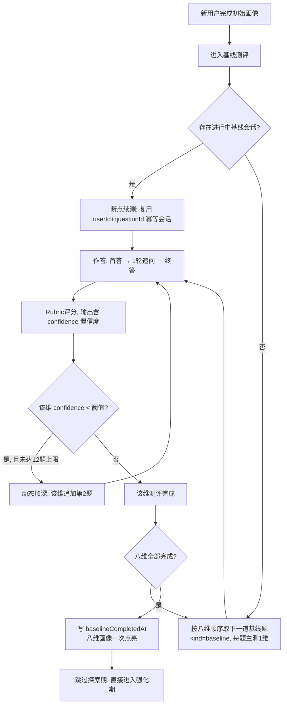
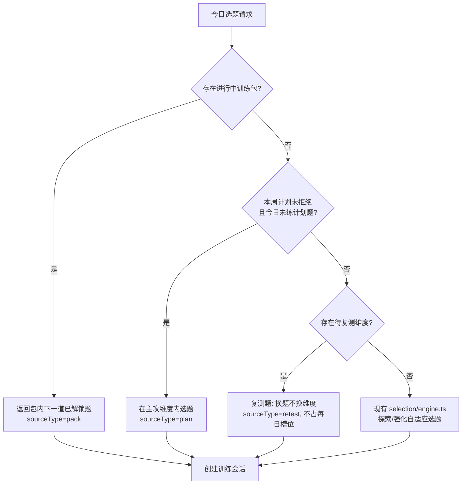
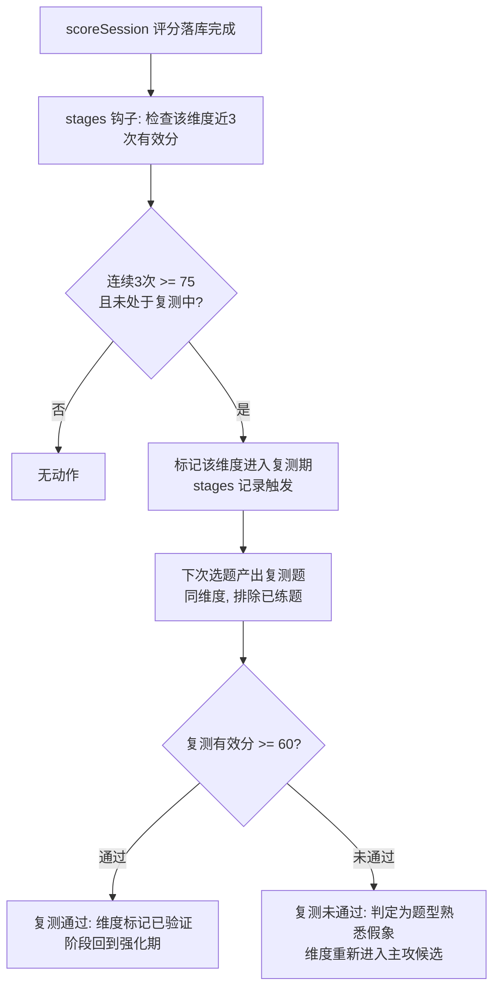
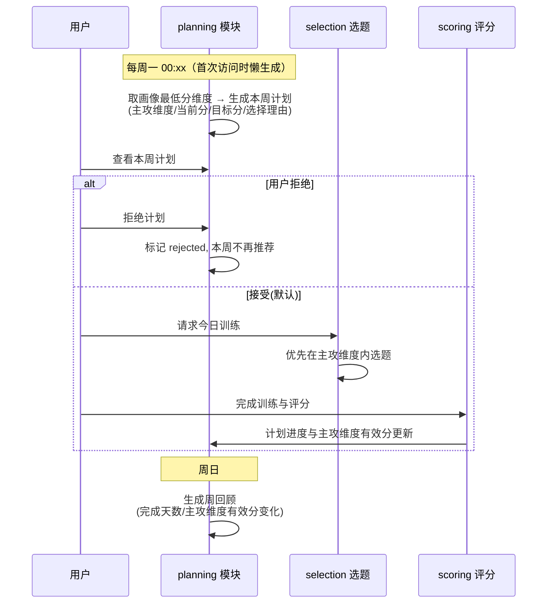
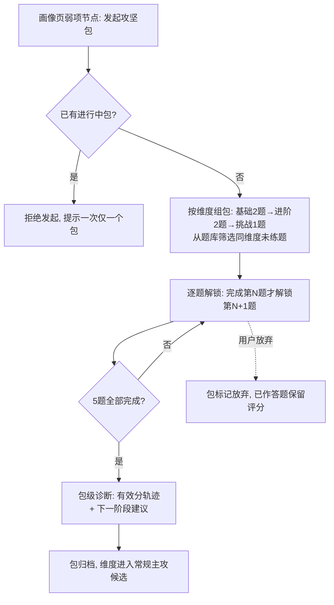
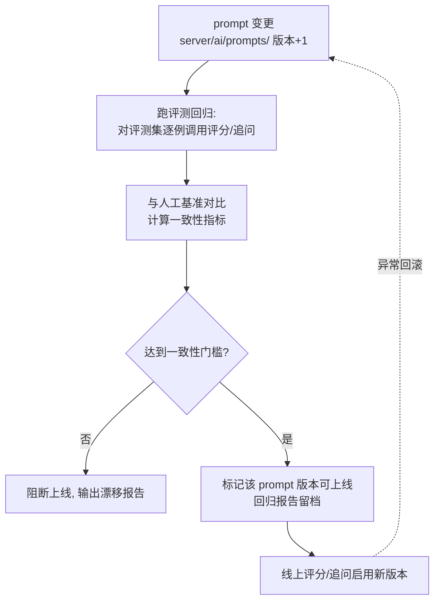

# V2 架构设计蓝图

> 文档类型：计划方案（docs/ 区，未实现的目标方案）
> 关联存档：[`prd-v2.md`](prd-v2.md)（路线图与原型设计说明）；视觉基准 [`v2-prototype-final.html`](v2-prototype-final.html)
> 事实来源：`server/modules/*`、`prisma/schema.prisma`、`maps/architecture.md`、`maps/features.md`（2026-10-07 探查）

## 1. V2 范围速览

| 编号 | 功能包 | 主要落点 |
|---|---|---|
| F7 | 基线测评升级（八维全覆盖） | baseline / scoring / prisma |
| F5 | 周期训练计划 | 新增 planning 模块 / selection / 首页 |
| F4 | 专项训练包 | 新增 packs 模块 / selection / 画像页 |
| F6 | 成长阶段与复测 | 新增 stages 模块 / scoring 钩子 / 画像页 |
| F3 | 总监 Agent 可度量调优体系 | server/ai + scoring / scripts / 评测集 |
| F1 | 题库扩容（日常 30~50 + 基线 16） | content/questions + 导入管线 |
| F2 | V1 小缺口修补 4 项 | onboarding 引导 / 历史显示 / 画像页 / 置信度展示 |

## 2. 核心流程图

### 2.1 基线测评升级（F7）

### 2.2 选题决策（V2 优先级：包 > 计划 > 自适应，含复测分支）

### 2.3 复测触发与判定（F6）

### 2.4 周期训练计划生命周期（F5）

### 2.5 专项训练包流程（F4）

### 2.6 总监调优回归门禁（F3）

## 3. 组件交互说明

### 3.1 受影响现有模块

| 模块 | 影响 | 说明 |
|---|---|---|
| `server/modules/baseline/` | 重构 | 从"2 道综合题"升级为"八维逐维测评 + 动态加深"；status 视图扩展为逐题进度；补 repository/schemas 分层 |
| `server/modules/scoring/` | 修改 | 评分 prompt 增加 confidence 输出；`scoreSession` 落库后触发 stages 钩子；scores 表加字段 |
| `server/modules/selection/engine.ts` | 修改 | 选题入口前置 V2 优先级链（包 > 计划 > 复测 > 现有引擎）；现有探索/强化逻辑保留为兜底分支 |
| `server/modules/training/service.ts` | 修改 | 会话创建支持 sourceType/sourceId；加练逻辑与包/计划解耦 |
| `server/modules/profile/ability-page.ts` | 修改 | 画像页视图增加弱项"发起攻坚包"入口状态（含"一次仅一包"禁用态）；顶部洞察由固定文案改为真实主攻结论（F2 修补项） |
| `app/training/` | 修改 | 大厅加入周计划卡、训练包卡；工作台支持包内进度展示 |
| `app/profile/` | 修改 | 画像页弱项节点加入发起入口（见 §5 风险 R1：3D 网络图去留待定） |
| `app/` 首页 | 修改 | 首页改为战役地图式（组合原型屏 1）：阶段路径 + 悬挂计划/包卡 |
| `server/modules/training/score-notifications.ts` | 小改 | 复测题/包题的完成通知沿用现有机制，确认排除规则 |

### 3.2 新增模块

| 新模块 | 职责 | 调用关系 |
|---|---|---|
| `server/modules/planning/` | 周计划生成（规则式）、拒绝、进度聚合、周回顾 | 读 profile（弱项）→ 被 selection 查询（主攻维度）→ 被首页/大厅展示 |
| `server/modules/packs/` | 训练包组包、逐题解锁、放弃、包级诊断 | 读 profile（弱项）+ content（同维度题）→ 创建 training 会话（sourceType=pack）→ 被画像页/大厅展示 |
| `server/modules/stages/` | 三阶段状态、复测触发判定、复测结果处理 | 被 scoring 落库后调用（钩子）→ 被 selection 查询（待复测维度）→ 被画像页展示 |
| `server/ai/prompts/` | prompt 独立文件化 + 版本注册表 | 被 followup.ts / rubric-scorer.ts 引用；被回归脚本遍历 |
| `server/modules/eval/`（或 scripts 扩展） | 评测集加载、回归执行、一致性对比、报告 | 读评测集（YAML）→ 调用 scoring/followup → 输出报告 |

### 3.3 数据契约变更（Prisma）

**修改现有表：**
- `TrainingSession`：新增 `sourceType`（daily/extra/baseline/plan/pack/retest）+ `sourceId`（计划/包 id，可空）。现有数据迁移回填：kind=baseline→baseline、isExtra=true→extra、其余→daily。
- `Score`：新增 `confidence`（0~100，可空，老数据为 NULL）。
- `Question`：新增 `domain`（领域标签，用于题库覆盖矩阵与计划维度匹配）；`difficulty` 已有（1~5）直接复用。

**新增表（草案字段）：**
- `training_plans`：`id, userId, weekStartDate, focusDimension, startScore, targetScore, status(active/rejected/completed), reason, createdAt`
- `training_packs`：`id, userId, dimension, status(active/completed/abandoned), createdAt, completedAt`
- `pack_items`：`id, packId, questionId, orderIndex, tier(basic/advanced/challenge), unlockedAt, sessionId`
- `stage_records`：`id, userId, dimension, type(retest_trigger/retest_pass/retest_fail), createdAt`
- `eval_cases`（或 YAML 文件管理）：题目 id、标准答案、人工评分基准、期望分数带
- `prompt_versions`：`id, name(scoring/followup), version, contentHash, status(draft/passed/active/rolled_back), createdAt`
- `eval_runs`：`id, promptVersionId, consistencyScore, report(Json), createdAt`

## 4. 技术选型与风险

### 选型决策

- **周计划生成：规则引擎，不用 AI 生成。** 主攻维度 = 当前画像最低分维度（同分按固定顺序），理由文案模板化。理由：可解释、零成本、零延迟、结果可单测；AI 生成放 V3 再议。
- **动态加深判定：评分置信度 + 规则阈值。** 评分 prompt 增加 `confidence`（0~100）输出，阈值初定 70（立项时用回归集标定）。避免引入第二模型做判定。
- **复测题选题：复用 selection 引擎的同维度过滤能力**，"换题不换维度"= 目标维度固定 + 排除已练题。依赖题库同维度题量（见 R3）。
- **prompt 管理：独立文件 + 版本注册表（DB 记录状态），Git 管内容。** 回滚 = 切换 active 版本，无需发版。
- **断点续测：复用现有 `{userId, questionId}` 幂等会话机制**（baseline service 已有先例），不引入新状态机。

### 风险清单

| # | 风险 | 影响 | 缓解 |
|---|---|---|---|
| R1 | ~~**3D 网络图去留**~~（已关闭，D35 裁定） | — | 2026-10-07 产品负责人裁定：**移除 3D 网络图**，画像页采用组合原型屏 6 的 8 维行内形式为唯一呈现；`ability-network.tsx` 及 3D 依赖的移除纳入 T30 画像页改造 |
| R2 | TrainingSession 增加 sourceType/sourceId 的数据迁移 | 现有会话历史回填错误会污染统计 | 迁移脚本 + 回填规则单测；回填后抽查 |
| R3 | 复测"换题不换维度"依赖每维度 ≥3 道未练题；题库不足时复测无法产出 | F6 功能空转 | F1 题库扩容是 F6 硬前置：每维度日常题 ≥6 道（D35 上调：组包 5 道 + 复测预留 1 道）；不足时复测触发挂起并提示 |
| R4 | 评测集生产工作量：30~50 题 × 每题 1~2 份标准答案 + 人工评分基准 | F3 周期失控 | 评测集与题库生产同批推进（每批题目入库时同步产出标准答案）；AI 起草 + 人工评审修订 |
| R5 | 选题优先级链（包>计划>复测>自适应）使选题行为复杂度上升，"为什么是它"解释链变长 | 用户困惑、可解释性下降 | SelectionOutcome 扩展 sourceType 与理由文案，每层优先级有固定解释模板 |
| R6 | 动态加深依赖 confidence 字段，MiMo 输出置信度的校准质量未知 | 加深触发过多（测评变长）或过少（八维分不准） | 阈值可配置；上线初期后台观测加深触发率，用回归集标定 |
| R7 | 基线题 16 道 + 日常 30~50 道的内容生产与评审周期 | P0 地基延期，阻塞后续全部 | 分三批、基线题第一批；沿用 YAML 校验管线；评审人 = 用户本人 |

## 5. 实施顺序（与路线图排期一致）

1. **P0**：F1 题库扩容（基线 16 题优先第一批）+ F2 小缺口修补
2. **P1**：F3 调优体系（评分可信度先行，为 F7 八维分打底）
3. **P2**：F7 基线升级（依赖 F1 基线题 + F3 置信度）
4. **P3**：F5 周计划 → F4 训练包 → F6 成长阶段（三者数据契约相互独立，可并行；建议按此顺序交付）
